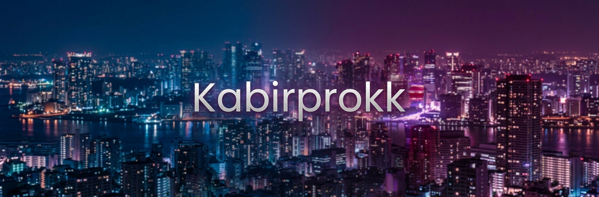

# Hi, I'm Kabir 👋

### Full-Stack Developer & AI Tooling Enthusiast

---

## About Me

I'm a passionate full-stack developer and AI tooling enthusiast who builds everything from browser extensions and no-code website builders to AI-powered developer tools, e-commerce platforms, and 3D simulations. I love creating tools that make developers' lives easier and building products that solve real problems.

- 🔭 Currently building **OSIEN** — an AI tooling ecosystem with MCP tools, skills, and agents
- 🌱 Exploring **AI agents**, **3D web experiences**, and **developer tooling**
- 💡 Passionate about **open source**, **AI automation**, and **creative coding**
- 📫 Reach me at: **kabirsayed.k@gmail.com**

---

## Tech Stack

### Languages

### Frontend

### Backend & Database

### AI & Tooling

---

## Featured Projects

### 🚀 OSIEN Ecosystem
A monorepo housing 15+ projects including AI tooling, web apps, games, and more.
- **[OSIEN](https://github.com/kabirprokk/OSIEN)** — Parent monorepo
- **[OSIEN-Forge](https://github.com/kabirprokk/OSIEN-Forge)** — Free AI superpowers: games, websites, brand kits, invoices
- **[OSIEN-Stack](https://github.com/kabirprokk/Osien-Stack)** — Portable AI tooling stack with 45+ MCP tools

### 🛒 Client Projects
- **[Driftpost](https://github.com/kabirprokk/Driftpost)** — Social media scheduling & publishing platform
- **[Famebook](https://github.com/kabirprokk/Famebook)** — Booking application
- **[parrfums-vault-storefront](https://github.com/kabirprokk/parrfums-vault-storefront)** — Perfume e-commerce storefront

### 🔧 Developer Tools
- **[OCM (OpenCode Marketplace)](https://github.com/kabirprokk/opencode-marketplace-web)** — Marketplace for OpenCode tools & skills
- **[Record-Common](https://github.com/kabirprokk/Record-Common)** — Video submission & review platform
- **[Gramiqo](https://github.com/kabirprokk/Gramiqo)** — Browser extension

### 🎮 Games & Experiments
- **[NeoGenesis](https://github.com/kabirprokk/NeoGenesis)** — 3D planet simulation with AI
- **[Synapse](https://github.com/kabirprokk/Synapse)** — Battle Ground of Two AIs
- **[AutoChargingCar](https://github.com/kabirprokk/AutoChargingCar)** — Auto-charging car simulation

### 📱 Web Applications
- **[Storyteller_v1](https://github.com/kabirprokk/Storyteller_v1)** — Interactive storytelling platform
- **[keepthestyle_v1](https://github.com/kabirprokk/keepthestyle_v1)** — No-code visual website builder

---

## GitHub Stats

---

## Connect With Me

- 💼 **GitHub:** [@kabirprokk](https://github.com/kabirprokk)
- 📧 **Email:** kabirsayed.k@gmail.com

---

*"Code is like humor. When you have to explain it, it's bad."*

